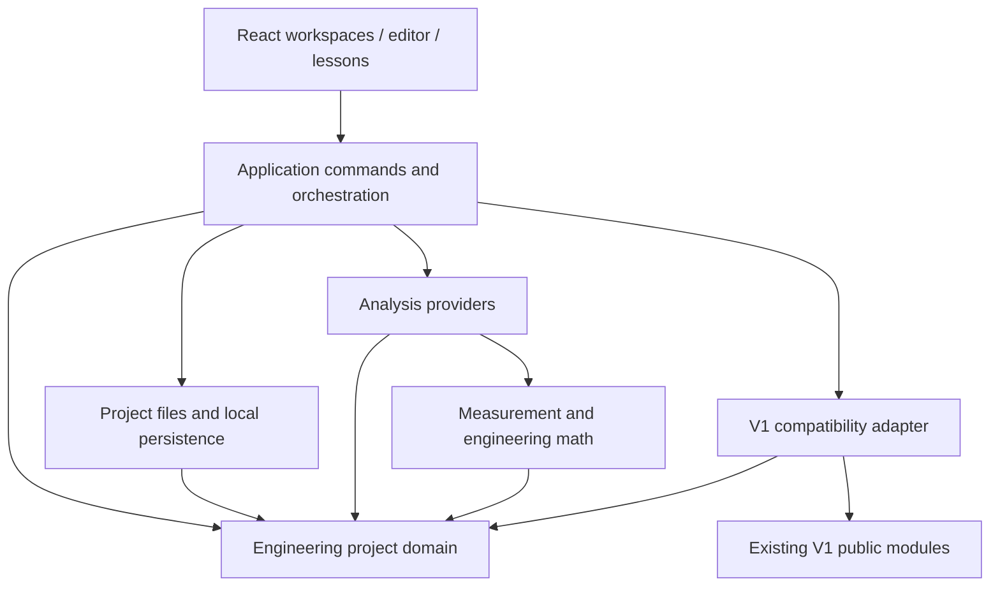

# V2 System Architecture

Status: V2.0-A design specification, 2026-10-20. No production V2 implementation.
Owner review outcomes and D03/D06 refinements are recorded in [DECISIONS.md](DECISIONS.md).
The confirmed product requirements remain in [PROJECT_CONTEXT.md](../PROJECT_CONTEXT.md).

## Scope and reading map

This design preserves the deployed application and specifies a local-first
engineering project foundation. It prepares a usable editor/V1 integration and
early measurement workflows without introducing a backend, SPICE runtime, PCB
editor, or new production dependency now.

| Deliverable | Design output |
| --- | --- |
| A01 | V1 reuse inventory and integration boundaries below |
| A02–A03 | [DOMAIN_MODEL.md](DOMAIN_MODEL.md) |
| A04 | [ENGINE_CONTRACTS.md](ENGINE_CONTRACTS.md) |
| A05 | [V1_COMPATIBILITY.md](V1_COMPATIBILITY.md) |
| A06 | [PROJECT_FORMAT.md](PROJECT_FORMAT.md) |
| A07 | [MEASUREMENT_DATA.md](MEASUREMENT_DATA.md) |
| A08 | [PCB_INTEROPERABILITY.md](PCB_INTEROPERABILITY.md) |
| A09 | [IMPLEMENTATION_ROADMAP.md](IMPLEMENTATION_ROADMAP.md) |
| A10 | [DECISIONS.md](DECISIONS.md), [ACCEPTANCE.md](ACCEPTANCE.md) |

## A01 — Current V1 contracts and reuse

Reviewed the existing architecture, public type/barrel files of domain, topology,
solver, transforms, visualization, and education, plus lesson-session state,
relevant layout/solver limits, design tokens/styles, package and deployment config.
This is a scoped interface review, not a full algorithm audit or fresh acceptance.

| Existing provider | Actual public boundary | Reuse and limits |
| --- | --- | --- |
| `src/domain` | `CircuitNetwork`, `createCircuitNetwork`, `resistanceOhms` | Preserve validation/snapshots; only explicit points, wires, finite positive resistors, terminals; not an unknown-JSON parser |
| `src/topology` | `analyzeTopology(network): TopologyResult` | Preserve wire equivalence, branch identity, terminal mapping; no geometry/React; canonical node IDs are derived, not permanent net identities |
| `src/solver` | `solveEquivalentResistance(topology, terminalAId, terminalBId)` | Reuse passive resistance analysis; finite/short/open/error states, diagnostics, selected component limit 512 unknown nodes; not general DC/MNA |
| `src/transforms` | `discoverTransformations`, `applyTransformation`, `verifyTerminalEquivalence` | Preserve four operations, protected boundaries, immutable results, trace metadata, all-terminal-pair evidence; numerical equivalence is not a symbolic proof |
| `src/visualization` | `buildDrawing`, `CircuitDiagram`, example circuits | Keep V1 comparison/lessons; automatic layout limited to 16 points/24 elements; do not make it the general editor layout |
| `src/education` | `buildLesson`, `lessonHighlights`, `formatNumber` | Reuse real input/result/evidence explanations for supported operations; fixed five-stage templates |
| App / `lesson-session.ts` | application composition, cached preview/evidence, reducer | Preserve existing route/workflow; add a workspace entry later, not a giant App rewrite |
| Shared presentation | `SiteHeader`, `ThemeToggle`, MathML, CSS tokens | Retain Stray identity and `stray-theme`; technical workspaces reuse semantic styles |

Public source references: [domain](../../src/domain/index.ts),
[topology](../../src/topology/index.ts), [solver](../../src/solver/index.ts),
[transforms](../../src/transforms/index.ts),
[visualization](../../src/visualization/index.ts), [education](../../src/education/index.ts).
Existing [V1 architecture](../ARCHITECTURE.md) remains the source for algorithm detail.
Historical M8-pending wording does not override the dated release record in
[DEPLOYMENT.md](../DEPLOYMENT.md).

## Proposed layers and dependency direction

Names below are proposed responsibility boundaries, not directories created now.

- Domain owns stable entities, explicit connections, parameters, immutable
  snapshots, and command invariants. It imports no React, browser storage, SVG,
  V1 implementation, instrument driver, or numerical engine.
- Connectivity resolution derives nets from the authoritative connection graph.
  It does not inspect coordinates or choose numerical ground references.
- File parsing validates unknown data and versions before constructing domain
  objects. Local storage is a replaceable consumer of serialized projects.
- Engines consume snapshots and declare capabilities. Analog numerical, digital
  event, signal analysis, and PCB checks have distinct outputs/methods.
- V1 adapters depend on V1 public barrels and V2 contracts; V1 does not import V2.
  Keep current ESLint boundaries; add narrowly scoped V2 boundary rules during
  implementation without broadening existing forbidden imports.
- Application orchestration checks scope/revision, invokes providers, and commits
  commands. Views render results and request commands; views do not recompute
  authoritative arithmetic.
- External runtimes communicate through explicit provider/asset interfaces. Do not
  introduce a generic plugin framework or require network access for V2.0.

## Commands, history, and analysis snapshots

An electrical edit is a transaction over a project snapshot: validate affected
references, allocate new IDs, apply changes, resolve connectivity, and commit one
history entry. Failure leaves the old snapshot intact. Placement and routing edits
are also commands; they never infer electrical connections from overlap.

Undo/redo restore complete before/after content while receiving a fresh revision
token for each committed state. IDs deleted by a command are restored on undo;
new IDs are not recycled. Runtime history/selection/caches are not mandatory file
content. Saving/reopening restores the project, not an unbounded undo stack.

Results record the input revision and an input digest. A changed snapshot makes
an old result historical until applicability/digest is checked again. Initial
implementation may conservatively invalidate on every revision, including
geometry-only changes. A later electrical digest can avoid needless reruns.
Never apply an asynchronous result or transform to a different source revision.

## Visual and workspace design boundary

Follow [DESIGN_SYSTEM.md](../DESIGN_SYSTEM.md), existing tokens, header, return-home
link, and theme lifecycle. Use a restrained workspace switch, component controls,
schematic canvas, properties/connectivity inspector, and results region when the
editor is implemented. The existing educational workspace remains reachable.

SVG is the recommended first editor renderer; its view model is independent of
V1 `buildDrawing`. Preserve scientific legibility, native keyboard controls,
visible selection beyond color, accessible status text, and internal diagram/
formula scrolling. Consider another renderer only after a measured need. No
pixel mockup, UI rewrite, or production version badge is part of V2.0-A.

## Boundaries intentionally deferred

Do not select a SPICE distribution, MCU simulator, FFT package, KiCad parser,
backend, cloud account, or hardware bridge before the corresponding module has
requirements. Define input/output boundaries now. Multi-sheet hierarchical
instantiation, buses, collaborative edits, and distributed history need separate
design before implementation; flat explicit multi-sheet connections suffice for
the proposed schema. No PCB manufacturability claim follows from these contracts.

## Architecture acceptance examples

1. Move a resistor symbol across a wire: placement changes, anchor graph unchanged,
   so connectivity and resistance remain unchanged.
2. Add an unsupported transistor to a selected V1 projection: adapter rejects the
   full scope with its entity ID; it cannot omit the transistor.
3. Run FFT on imported samples without a schematic: signal engine consumes the
   dataset, not a fabricated electrical circuit.
4. A transform finishes after the project changes: stale revision prevents writeback.
5. A board preview exists without checked net/pad mappings: mark checks not run;
   manufacturing export remains unavailable.
