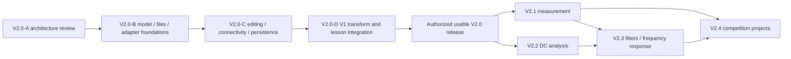

# Phased Implementation and Release Gates

Status: V2.0-A design output (A09). This plan does not authorize future modules,
commits, remote pushes, installs, or releases. Full planned scope remains in
[LONG_TERM_ROADMAP.md](../LONG_TERM_ROADMAP.md); completed M0–M8 history remains in
[ROADMAP.md](../ROADMAP.md).

## Dependency order

The measurement data contracts do not require a general analog solver. Release
order follows priorities, but implementation dependencies do not force FFT to wait
for MNA. Each module is separately scoped and authorized; later generations remain
adjustable rather than fixed dates.

## V2.0-A — Current internal design milestone

Ten deliverables A01–A10 are tracked in
[DEVELOPMENT_PROGRESS.md](../DEVELOPMENT_PROGRESS.md). Complete specifications,
cross-document examples, recorded tradeoffs/owner-review items, consistency checks,
and [acceptance evidence](ACCEPTANCE.md). No production code, new dependencies,
UI, deploy configuration, version bump, or deployment. Internal Verified status is
separate from owner approval and Released.

## V2.0-B — Engineering model and file foundation

**Scope:** implement the reviewed minimal domain, explicit graph resolution,
multi-pin definitions/instances, stable IDs, finite units/parameters, immutable
snapshots, version-1 JSON parsing/export, asset manifest, migration framework, and
V1 example import/eligible projection. Preserve V1 algorithms and workspace.

**Proposed responsibilities/files:** new engineering/domain and connectivity
modules, project-file module, and a V1 compatibility module with public barrels;
exact directories are chosen in the implementation task. Add dependency rules only
for those boundaries. No editor or new simulator is necessary for this internal stage.

**Acceptance:** targeted tests for pin/anchor invariants, label scope, isolated and
shorted structures, geometry-independent nets, global ID/reference validation,
serialization/assets/unknown versions/extensions, and V1 import/projection identity
mapping. Include a structurally valid unsimulated multi-pin example. Initial
projection rejects cross-sheet connections and unsupported component models.
No invented migration fixture from a nonexistent legacy file version.

Run standard checks once at final integration. Update architecture, file
compatibility notes, progress, and handoff. B is not a usable editor release.

**Entry condition:** D01–D06 review outcomes are recorded in DECISIONS.md and the
D03/D06 refinements are reconciled. Separate owner authorization to implement B
is still required. Deferred long-term formats/backends do not block this foundation.

## V2.0-C — General schematic editing workflow

**Scope:** independent SVG editor view model; resistor/component palette,
selection/place/move/rotate/delete, explicit pin wiring, junction/crossing rules,
properties, ports/reference/labels, connectivity inspection, basic ERC, undo/redo,
keyboard shortcuts, and local save/reopen plus file import/export. Start with one
editable sheet. General multi-pin presentation is supported without claiming an
engine for every component.

**Interfaces:** all edits are atomic application commands over B's domain;
rendering consumes placements/routes; persistence consumes validated files.
Keep the existing V1 educational workspace available throughout.

**Acceptance:** build a resistor circuit from empty, connect it, edit values,
move/rotate while preserving connectivity, deliberately distinguish crossings
from junctions, undo/redo deletion, save/export/reopen, and inspect an unsupported
simulation component without discarding it. Check keyboard flows and representative
desktop/mobile light/dark layouts, overflow, header/theme synchronization, and
MathML access in V1. Verify quota/failed import leaves existing work usable.

No automatic routing, PCB editing, cloud collaboration, or source-driven simulation.
Run checks and scoped browser verification once at the final integration milestone.
C contributes to the integrated V2.0 workflow; do not deploy an incomplete shell.

## V2.0-D — V1 transformation and education integration

**Scope:** discover/preview/verify/commit eligible transforms from editable circuits;
protected boundaries/probes; one undoable writeback with ID/provenance mapping;
current V1 guided explanations over actual computation. Preserve original example
access, visual comparison, all result states, and explicit unsupported boundaries.

**Acceptance:** existing four operations from supported editable networks, external
port preservation, direct wire and self-loop cases, protected centers, label scope,
stale-revision rejection, mapped-pin removal rejection, and clear inconclusive/
numerical-error feedback. Do not test numerical algorithms by duplicating them in
adapters. Cover changed integration boundaries and representative V1 journeys.

**V2.0 public gate:** B+C+D form a complete project editing/save/reopen/transform/
learn workflow; reviewed contracts implemented, meaningful acceptance passed,
version/changelog/compatibility/release records prepared, and essential V1 behavior
preserved. Target semantic version `2.0.0` is conditionally approved under D09;
establish versioning, changelog, compatibility, and rollback procedures before release.
Only an explicitly authorized release task integrates/pushes/deploys, watches
Actions, verifies the actual public workflow/assets, and records exact commit/version.

## V2.1 — Early measurement and instrumentation release

Deliver generation, waveform display/navigation, total/AC RMS and amplitude
measurements, a correctly normalized FFT, multi-channel comparison, and CSV
import/export. Distinguish simulated/imported/hardware origins, raw/derived data,
units, sampling limitations, and unavailable measurements. Hardware drivers,
advanced THD, and calibrated instrument claims require their own scope.

Acceptance uses analytic signal fixtures, known CSV/axis failures, FFT window/
normalization checks, and the complete generate/import → inspect → measure → export
workflow. Publish the independently usable module through the authorized lifecycle;
proposed semantic version `2.1.0` is a target, not an existing tag.

## V2.2–V2.4 — Next scoped releases

| Module | New responsibility | Representative acceptance |
| --- | --- | --- |
| V2.2 DC | Sources, MNA, actual equations/solutions and educational display | Hand-derived source/controlled-source circuits, reference/floating/source-conflict diagnostics, KCL/power checks; retain V1 passive provider |
| V2.3 filters/AC | RLC models, frequency sweeps, phase, Bode, measurement comparison | RC/RLC analytic limits, declared RMS/phasor conventions, gain/phase/frequency units, supported model applicability |
| V2.4 competition | Verified past-problem sources, measurable indicators, test records and reports | One sourced representative National/Guangdong workflow with year/division/category attribution; distinguish simulated/measured evidence and actual scoring requirements |

Signal measurement/instrumentation/filter workflows remain the first competition
priority. Actual contest requirements must be sourced when that module begins;
this design invents neither problem statements nor official rules.

## V3.x–V6.x — Long-term expansion

- V3.x: advanced circuit theory and analog electronics, dynamic/nonlinear models,
  amplification and power experiments; evaluate mature simulation engines as needed.
- V4.x: logic/event simulation, embedded peripherals, communication, acquisition,
  control, and selected vision workflows, with explicit hardware/runtime boundaries.
- V5.x: validated schematic-to-PCB mappings, footprints/layout/checks, 2D/3D, BOM,
  mature-EDA interchange, and manufacturing exports only after appropriate gates.
- V6.x: advanced subject-specific and multi-domain engineering projects.

All 18 textbook chapters, analog/digital topics, internships, learning progress,
reports, and competition coverage remain tracked by the full long-term roadmap.
Create source-backed coverage matrices when those modules begin, without guessing
chapter titles or marking text-only pages as interactive experiment completion.

## Common release and handoff procedure

Development → scoped testing → integration → standard checks/build → actual version
and changelog/compatibility update → authorized deployment → live verification →
progress/handoff record. Include representative browser checks and saved-project
access, preserving Stray design and the existing public URL. Use
[DEPLOYMENT.md](../DEPLOYMENT.md) and record a history-preserving rollback route.

A failed/live-unverified release remains internally complete/verified as applicable,
never Released. Record concrete blockers without claiming success. Design milestones
need only lightweight checks. Never rerun historical acceptance aimlessly, commit
every progress message, or advance to the next module without task authorization.
